# Blood Moon para o T3 Code

Tema escuro em preto e vermelho neon para o [T3 Code](https://github.com/pingdotgg/t3code), com uma cena animada em pixel art atrás da conversa: uma lua de sangue, um vampiro em cima de uma torre em ruínas, um cemitério e morcegos voando.



## O que tem

**Cena da conversa**
- Lua de sangue com brilho pulsando e nuvens escuras passando na frente.
- Vampiro de asas abertas no alto da torre: olhos vermelhos que piscam e asas que fecham de vez em quando.
- 12 morcegos: alguns cruzam a tela, três rodam em volta da lua e um bando sai da torre.
- Cemitério com mausoléu, lápides, cruzes, cerca de ferro e velas acesas.
- Estrelas piscando, estrela cadente, brasas subindo, neblina vermelha no chão e um relâmpago a cada ~40 segundos.

**Resto do app**
- Barra lateral com mini-cena de cemitério no rodapé, névoa vermelha subindo e borda neon pulsando.
- Conversa aberta com barrinha neon pulsando; linhas que deslizam e acendem ao passar o mouse.
- Ícones dos projetos brilhando e nomes dos projetos em maiúsculas.
- Caixa de mensagem, menus, botões, blocos de código e terminal em vermelho neon.
- Névoa vermelha na tela de configurações.

## Como instalar

1. Baixe o [`blood-moon.json`](blood-moon.json) (na página do arquivo, use o botão de download ou salve a versão **Raw**).
2. No T3 Code, abra **Settings → Appearance** e clique em **Add a theme**.
3. Arraste o `blood-moon.json` para a caixa ou cole o conteúdo dele.
4. Escolha **Blood Moon** e deixe o T3 Code no modo escuro.

## Observações

- **Só modo escuro.** O tema foi feito para o modo escuro.
- **Precisa de uma versão do T3 Code com temas** (Settings → Appearance → Add a theme).
- **Computador e web.** O app do celular não usa temas personalizados.
- **Menos movimento.** Se o sistema estiver com "reduzir movimento" ou "efeitos de animação" desligados, tudo fica parado.
- **Sem internet.** As cenas são SVGs dentro do próprio CSS; nada é baixado.
- **Partes que podem quebrar numa atualização.** Algumas partes usam atributos internos do T3 Code, fora da lista de seletores garantidos para temas:
  - o destaque da conversa aberta, o efeito ao passar o mouse nas linhas da barra lateral e os nomes dos projetos em maiúsculas (`data-sidebar-row` e `aria-current`);
  - a cena no painel principal (`data-slot="sidebar-inset"`), que faz ela aparecer também na conversa nova, antes da primeira mensagem.

  O resto usa só os seletores garantidos.

## Como mexer

O `blood-moon.json` é gerado. Para mudar o tema, edite os arquivos de `src/` e rode:

```sh
node src/build.mjs
```

- `src/build.mjs`: desenha as cenas (pixel a pixel) e monta o tema. Também grava `scene.svg`, a cena sozinha, para ver no navegador.
- `src/base.css`: o CSS do tema. `__SCENE__` e `__MINI__` são trocados pelas cenas.
- `src/colors.json`: as cores do app.

O T3 Code aceita até 50.000 caracteres de CSS por tema; o build avisa se passar.

Para atualizar um tema já instalado sem reinstalar, passe o arquivo dele (fica em `.t3/userdata/themes/` na sua pasta de usuário):

```sh
node src/build.mjs caminho/para/o-tema.json
```

Depois troque de tema e volte, ou reabra o app.

## Créditos

A técnica de colocar uma cena animada em SVG no fundo da conversa veio do [Pixel Quest](https://github.com/Jonathon-Sherrouse/t3code-pixel-quest). A arte e o código deste tema são próprios.
